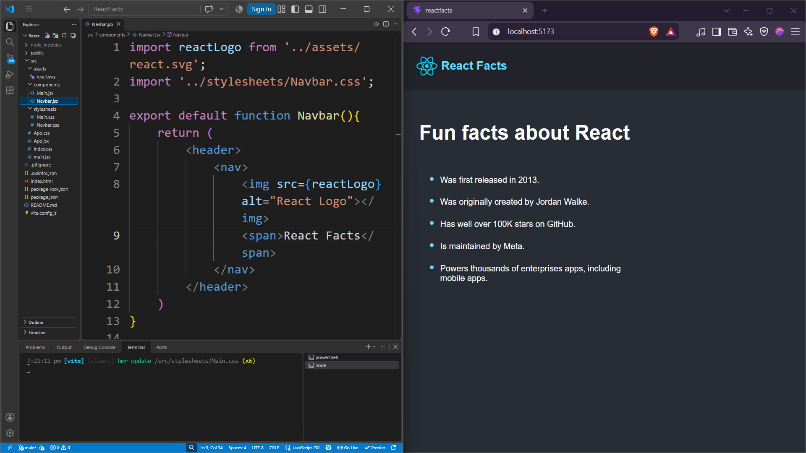

## PROJECT - 8 : React Facts

| Project No. | Project Name | Technologies |
|---|---|---|
| 8th | React Facts | HTML5, CSS3, JavaScript (JSX) ,React, Vite |

### Description

A simple and static React Facts webpage built using React.js and Vite. The project displays interesting facts about React. It demonstrates the fundamentals of React development, including creating functional components, using JSX, importing assets, and organizing components with separate CSS stylesheets.

### What I Learned

##### Through this project, I learned:
- Setting up a React project using Vite.
- Understanding the basic React project structure.
- Creating functional components in React.
- Understanding JSX syntax.
- Using import and export to organize components.
- Running a React application using the Vite development server.
- Understanding the basics of component-based UI development.

## Project Preview

